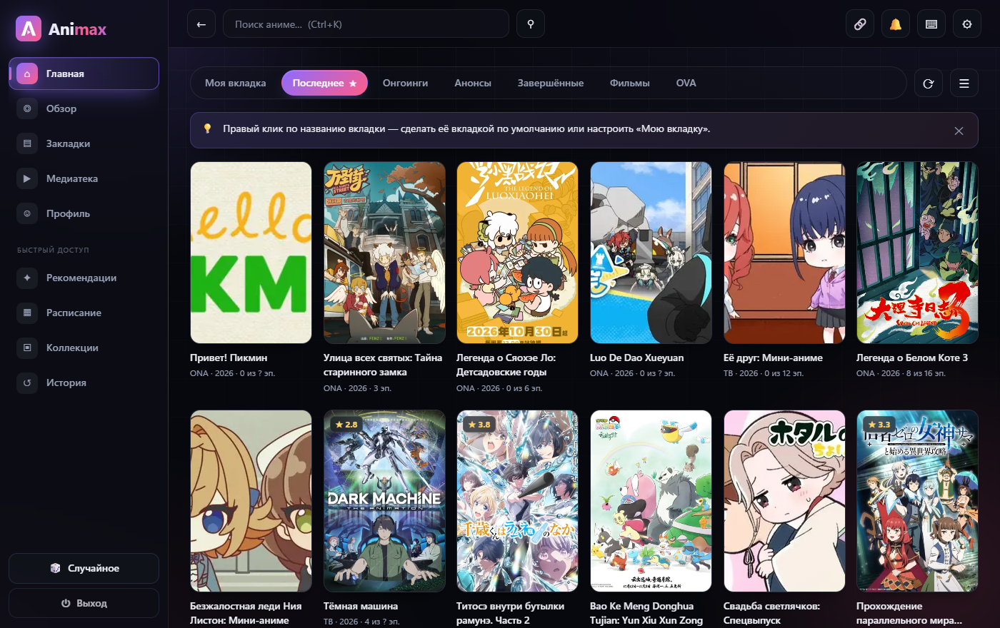
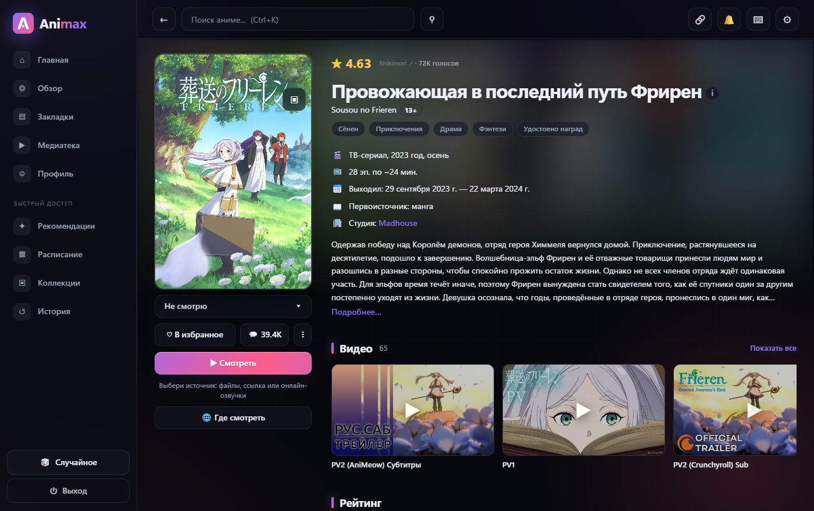

  

<h1 align="center">Animax</h1>

Аниме-клиент для Windows: каталог, онлайн-озвучки, закладки и свой плеер в одном окне.

  
  
  
  

  <a href="https://github.com/0verLorD228/Animax/releases/latest"><b>Скачать</b></a> ·
  <a href="#возможности">Возможности</a> ·
  <a href="#вопросы-и-проблемы">Вопросы и проблемы</a> ·
  <a href="#дисклеймер">Дисклеймер</a>

  

## Возможности

- Каталог Shikimori: поиск, фильтры, расписание, рекомендации, коллекции.
- Онлайн-озвучки Anixart, AniLiberty и Kodik с выбором серии и качества.
- Свой плеер: качества, субтитры, скорость, автопереход и горячие клавиши.
- Списки «Смотрю», «В планах», «Просмотрено», «Отложено», «Брошено», а также оценки, заметки и история.
- Уведомления о новых сериях, премьерах и ответах — в приложении и в Windows.
- Медиатека: свои папки с видео и субтитрами.
- Синхронизация закладок и оценок с Shikimori, если войти в аккаунт.
- Значок в трее, отдельное окно плеера и режим «поверх всех окон».
- Лёгкий режим для слабых компьютеров включается сам.

<table>
  <tr>
    <td></td>
    <td></td>
  </tr>
</table>

## Скачать и установить

Все файлы — на [странице последнего релиза](https://github.com/0verLorD228/Animax/releases/latest).

| Файл | Что это |
|---|---|
| `Animax-1.0.0-win64-setup.exe` | Установщик. Права администратора не нужны, Animax появится в меню «Пуск». |
| `Animax.exe` | Портативная версия: запускается без установки. |

**Что нужно:** Windows 10 или 11 (64 бита), Microsoft Edge (в этих системах он уже есть) и интернет для каталога и онлайн-озвучек. Комфортно работает на 4 ГБ памяти и 2 ядрах.

Обновляется Animax вручную: скачай новую версию со страницы релизов. Закладки и настройки хранятся отдельно, в `%APPDATA%\Animax`, и при обновлении или удалении программы остаются на месте.

## Вход в Shikimori

Смотреть каталог и озвучки можно без аккаунта. Вход нужен для синхронизации закладок и оценок, комментариев и отзывов.

Для входа нужно один раз создать своё приложение на Shikimori и вставить два ключа. Пошаговая инструкция есть в программе: **Настройки → Аккаунт**. Ключи и данные входа хранятся только на твоём компьютере.

## Вопросы и проблемы

<b>Windows пишет «Windows защитила ваш компьютер»</b>

Это предупреждение SmartScreen: у программы нет платной цифровой подписи. Нажми «Подробнее» → «Выполнить в любом случае».

<b>Антивирус удаляет Animax.exe</b>

Однофайловые сборки PyInstaller иногда ошибочно определяются как угроза, например `Trojan:Win32/Bearfoos.B!ml`. Скачивай Animax только со страницы релизов этого репозитория. Если не хочешь использовать exe, [запусти программу из исходников](.github/CONTRIBUTING.md#запуск-из-исходников).

<b>Пишет, что порт 8790 занят</b>

Этот порт заняла другая программа. Закрой её или перезагрузи компьютер, затем запусти Animax снова.

<b>Крестик закрыл окно, но Animax работает</b>

Так задумано: программа остаётся в трее. Чтобы закрыть её полностью, нажми «Выход» в приложении или в меню значка у часов.

Не нашёл ответа — [создай Issue](https://github.com/0verLorD228/Animax/issues).

## Для разработчиков

Запуск из исходников, тесты, структура проекта и сборка описаны в [CONTRIBUTING](.github/CONTRIBUTING.md). Как сообщить об уязвимости — в [SECURITY](.github/SECURITY.md). История версий — в [CHANGELOG](CHANGELOG.md).

## Дисклеймер

> [!IMPORTANT]
> Animax — неофициальный клиент для личного использования. Он не хранит и не размещает видео: программа показывает материалы сторонних сервисов. Проект не связан с Shikimori, Anixart, AniLiberty, Kodik и правообладателями. Все права на видео, обложки, описания и другие материалы принадлежат их владельцам.

Лицензия [MIT](LICENSE) относится только к коду Animax и не даёт прав на контент третьих лиц. Если ты правообладатель и хочешь сообщить о проблеме, [создай Issue](https://github.com/0verLorD228/Animax/issues).

Плеер использует библиотеку [hls.js](https://github.com/video-dev/hls.js) ([Apache-2.0](animax/web/vendor/hls.js.LICENSE.txt)).
